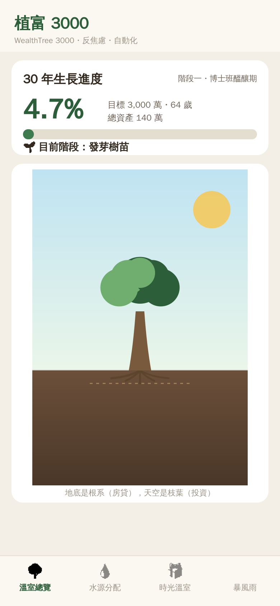
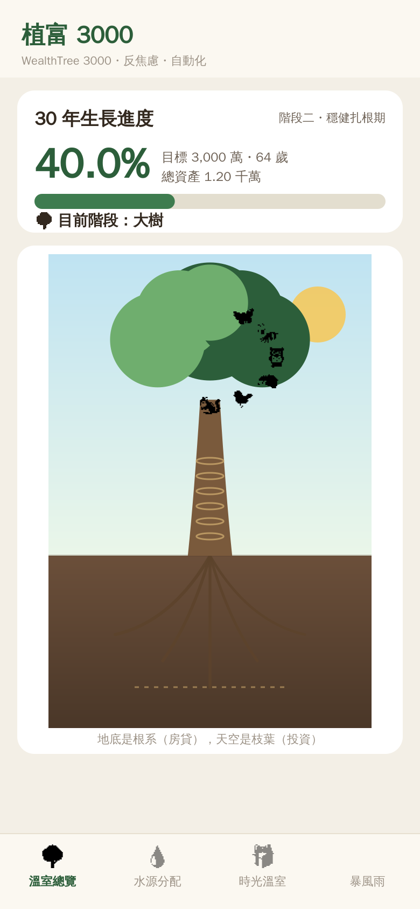
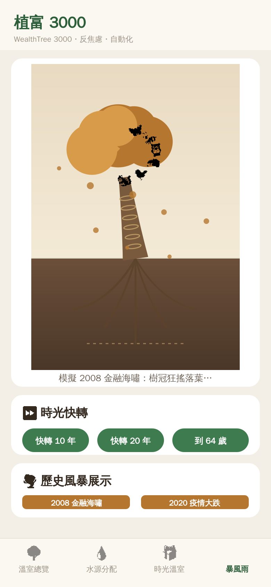
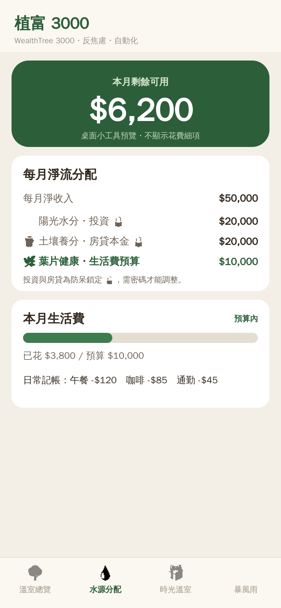
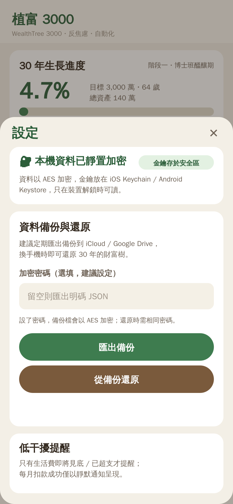

# 植富 3000 (WealthTree 3000)

> 為長期投資者打造的**反焦慮**記帳與目標管理 App。
> 用「植物生長」的視覺回饋取代冷冰冰的帳面損益，把注意力從「市場波動」轉移到「紀律執行」。

這是一個以 **Expo (React Native)** 打造的**可運行原型**，同時支援 **iOS / Android / Web**。
核心目標：在 30 年後（64 歲）培育出象徵 3,000 萬資產的「千年神木」。

完整產品規格見 [`SPEC.md`](./SPEC.md)。

## 畫面預覽

| 溫室總覽・起步樹苗 | 溫室總覽・15 年後 | 暴風雨・2008 模擬 | 水源分配器 | 設定・加密備份 |
|:---:|:---:|:---:|:---:|:---:|
|  |  |  |  |  |

> 上圖由 [`tools/render.mjs`](./tools/render.mjs) 產生：直接重現 `WealthTree.tsx` 的繪圖程式（座標、path、配色完全相同），套上手機外框後以 `sharp` 轉 PNG，供無頭環境預覽。樹的視覺即 App 實際畫出的樣子；emoji 在此渲染器為單色，於裝置上會是彩色。重跑：`npm i sharp && node tools/render.mjs`（需系統 CJK 字型）。

---

## 快速開始

```bash
npm install

# 手機（掃 QR code，需安裝 Expo Go）
npm start

npm run ios       # iOS 模擬器（需 macOS）
npm run android   # Android 模擬器
npm run web       # 瀏覽器預覽
```

> 環境：Node 22、Expo SDK 56、React 19、React Native 0.85。
> 原型資料**只存在裝置本機**（AsyncStorage），開發方伺服器不留存任何明碼財務數據。

## 部署到手機

把 App 裝到自己的 iPhone / Android（用 EAS Build，免 Mac）的完整步驟見 [`DEPLOY.md`](./DEPLOY.md)。
最快路徑（Android）：

```bash
npm i -g eas-cli && eas login && eas init
eas build -p android --profile preview   # 打包完用手機開下載連結即可安裝 APK
```

## 網頁版（GitHub Pages）

已內建自動部署 workflow（`.github/workflows/deploy-web.yml`）。推送到分支後，GitHub Actions 會打包 web 版並發佈到：

**https://yunching0513.github.io/WealthTree3000/**

啟用一次即可：repo **Settings → Pages → Source** 選 **GitHub Actions**。之後每次 push 自動更新。
手動本機打包：`EXPO_WEB_BASE_URL=/WealthTree3000 npx expo export -p web`（輸出在 `dist/`）。

> 網頁版說明：資料存在「該瀏覽器」的 localStorage（換裝置不跟著走，適合展示/試用）；
> 通知功能在 web 不啟用；大盤指數的即時抓取在瀏覽器可能因來源 CORS 而失敗，會自動沿用模擬值。

---

## 四大模組（對應規格）

| 分頁 | 模組 | 內容 |
|------|------|------|
| 🌳 溫室總覽 | Dashboard | 30 年生長進度條、生命週期階段、財富樹主視覺、天氣（季節）系統、年輪與陪伴動物 |
| 💧 水源分配 | 預算與現金流 | 每月淨流 5 萬分配、投資 / 房貸**防呆鎖定**（需密碼）、極簡記帳、桌面小工具預覽（只顯示剩餘餘額） |
| 🎁 時光溫室 | 投資與資產追蹤 | **盲盒模式**（不顯示日 / 週損益）、月度解鎖生長報告（股債比例、實際市值）、第 15 年再平衡提醒 |
| 🌪️ 暴風雨 | 壓力測試與心理建設 | 時光快轉（複利投影動畫）、歷史風暴模擬（2008 / 2020，狂搖落葉後復原更高大） |

## 植物系統：財務行為 → 樹的生長

| 財務行為 | 視覺對應 | 程式位置 |
|----------|----------|----------|
| 總資產（投資＋房屋淨值） | 樹苗 → 小樹 → 大樹 → 巨木 → 千年神木 | `growthFactor`, `currentStage` |
| 每月投資 2 萬（陽光水分） | 樹冠長新葉、散發光芒 | `monthlyInvest` |
| 房貸還款 2 萬（樹根系統） | 根系在土壤中扎得更深 | `rootDepth`, `makeRoots` |
| 生活費控管（葉片狀態） | 預算內翠綠；超支轉黃掉落 | `leafHealth`, `makeFallingLeaves` |
| 連續 12 個月紀律（年輪） | 樹幹增加一圈年輪 + 解鎖陪伴動物 | `rings`, `unlockedCompanions` |
| 大盤長期趨勢（天氣） | 春夏繁盛 / 秋冬落葉 | `seasonFromTrend`, `seasonInfo` |

## 專案結構

```
App.tsx                       # 根元件：分頁外殼 + Provider
src/
  theme.ts                    # 大地色系 + 多層次綠的設計 token
  store/
    finance.ts                # 領域邏輯（純函式）：資產、生長階段、投影、風暴情境
    AppContext.tsx            # 全域狀態 + 本機持久化（含市場同步、靜置加密、遷移）
    secureStorage.ts          # 靜置加密：AES + 金鑰存於 Keychain/Keystore
    backup.ts                 # 加密備份 / 還原（分享面板 + 文件選擇器）
  services/
    market.ts                 # 真實大盤指數（Stooq）→ 趨勢 → 季節；離線快取
    notifications.ts          # 低干擾本機通知（超支提醒、靜默扣款）
  components/
    WealthTree.tsx            # 核心視覺：以 SVG 把財務狀態畫成一棵樹
    TabBar.tsx                # 自製底部分頁列（零導航依賴）
    ui.tsx                    # 共用元件：卡片、進度條、按鈕、藥丸標籤
  screens/
    DashboardScreen.tsx       # 溫室總覽
    BudgetScreen.tsx          # 水源分配器
    GreenhouseScreen.tsx      # 時光溫室
    StormScreen.tsx           # 暴風雨模擬器
    SettingsModal.tsx         # 設定：加密狀態 / 備份還原 / 通知
```

## 原型已實作 vs 待補

**已實作**：四大模組畫面、財富樹 SVG（生長 / 根系 / 季節 / 葉片健康 / 年輪 / 陪伴動物 / 風暴傾斜）、
本機持久化、防呆密碼鎖、盲盒模式、月度結算與複利成長、複利快轉與歷史風暴動畫、
**本機靜置加密**（at-rest，AES 加密 AsyncStorage 內容，金鑰存於 iOS Keychain / Android Keystore，並自動遷移舊版明碼）、
**加密備份 / 還原**（經系統分享面板匯出到 iCloud / Google Drive，伺服器不接觸資料）、
**真實大盤指數串接**（Stooq 月線 S&P 500，無金鑰；離線快取、僅每月連網一次，驅動天氣/季節）、
**低干擾本機通知**（生活費即將見底 / 已超支提醒；每月扣款成功僅靜默通知）、
**台股看盤**（加權 / 櫃買指數、三大法人買賣超、自選股報價與走勢圖：紅漲綠跌、盤中自動更新、多來源容錯）。

**待補（正式版）**：匯率串接、原生桌面 Widget。

## 驗證狀態

- ✅ `npx tsc --noEmit` 型別檢查通過
- ✅ `npx expo export --platform web` 完整打包成功（444 modules，無錯誤）
- ✅ 純邏輯單元測試：備份加解密往返、大盤趨勢→季節映射
- ✅ 本機靜態伺服器可正常提供頁面與 JS bundle

> 註：本開發環境的網路政策未開放瀏覽器二進位下載與外部 API；上方預覽圖由離線渲染器
> 重現真實繪圖程式產生，大盤指數則需在你自己的裝置上連網實測。
> 請以 `npm run web` 或 `npm run ios/android` 在本機完整預覽互動。
